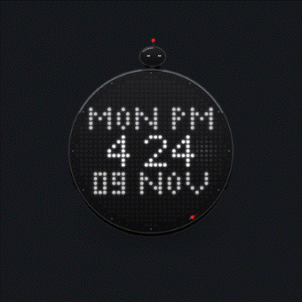
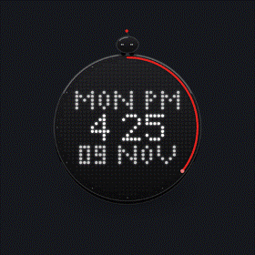
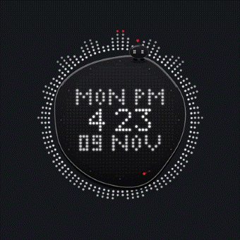
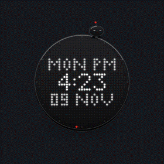
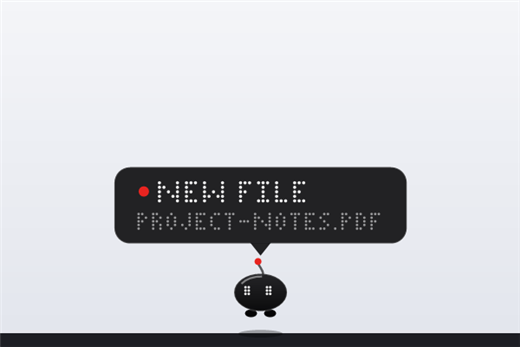
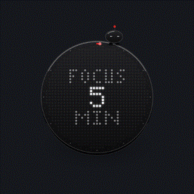
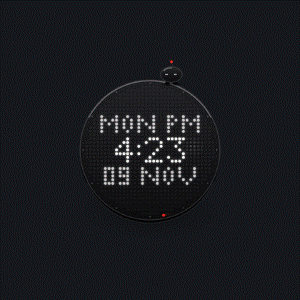
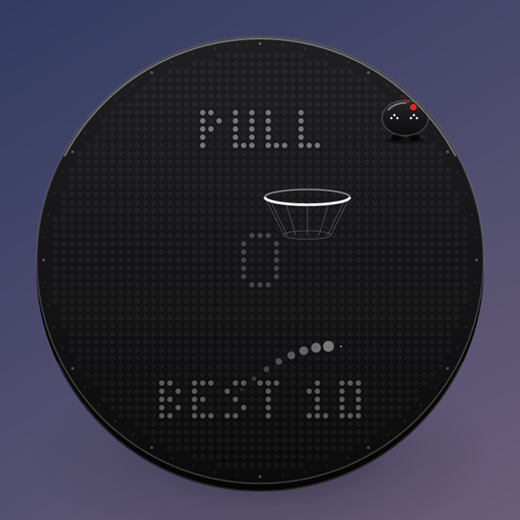
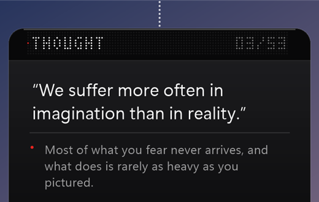

<div align="center">

<picture>
  <source media="(prefers-color-scheme: dark)" srcset="docs/media/wordmark-dark.png">
  
</picture>

### A living dot-matrix clock for your Windows desktop.

A matte black glass puck with a dot-matrix display behind the glass.<br>
It greets you by name, dances to your music, keeps your notes, runs your focus sessions,<br>
and has a tiny pet that taps you on the shoulder when something matters.

<br>

<a href="https://github.com/GalacticVraj/obsidot/releases/latest/download/Obsidot.zip"></a>

<br><br>

<a href="https://github.com/GalacticVraj/obsidot/releases/latest"></a>


<a href="LICENSE"></a>

<br><br>



<sub>One 219 KB file. No installer, no account, no internet. Unzip, double-click, done.</sub>

</div>

<br>

## Get it in 10 seconds

1. **[Download Obsidot.zip](https://github.com/GalacticVraj/obsidot/releases/latest/download/Obsidot.zip)** and unzip it anywhere.
2. Double-click **`Obsidot.exe`**. It asks what to call you.
3. Press **Win + D**. It's on your desktop, saying good morning.

<details>
<summary><b>Windows says "Windows protected your PC"?</b></summary>
<br>

That's SmartScreen being careful with a new app from an independent developer. Click **More info → Run anyway**. Obsidot is open source: every line it runs is in [`src/`](src), and you can [build it yourself](#build-it-yourself) in one step.
</details>

<br>

## It knows you

<table>
<tr>
<td width="50%" align="center"></td>
<td width="50%">

### Good morning, Vraj.

The first time it starts, dots stream in from the edges of your screen and assemble the clock, then it asks your name. From then on it greets you by it: **GOOD MORNING**, **GOOD EVENING**, **HELLO NIGHT OWL**, and **WELCOME BACK** when you return after a while away.

Want a different name? Right-click the little pet.

</td>
</tr>
</table>

## It dances to your music

<table>
<tr>
<td width="50%">

### A round spectrum analyser, in dots.

Play anything (Spotify, YouTube, a game) and rays of dots shoot out of the rim: bass at twelve o'clock, treble at six, the loudest tip glowing red. The edge of the puck turns liquid and wobbles with every kick drum.

Silence puts it back to sleep.

</td>
<td width="50%" align="center"></td>
</tr>
</table>

## A pet that lives on your desk

<table>
<tr>
<td width="50%" align="center"><br><br></td>
<td width="50%">

### It watches, naps, and brings you news.

A tiny black-glass creature sits on top of the puck. Its eyes follow your cursor, it blinks, it hops along the rim and bobs to the beat. Click it for a heart. Walk away and it falls asleep, Z's drifting up and its antenna pulsing like a standby light.

When something matters, **just the pet** drops onto the window you're working in, holding a sign:

| | |
|---|---|
| **FOCUS DONE** | your focus session ended |
| **BREAK TIME** | 50 minutes without a pause |
| **BATTERY 12%** | plug in soon |
| **NEW FILE** | a download finished. Click to open its folder |

Move that window and it tumbles off onto the taskbar. It never interrupts a full-screen film or game.

</td>
</tr>
</table>

## Built for focus

<table>
<tr>
<td width="50%">

### A kitchen timer, made of light.

Pick **Focus Timer**, scroll to wind the red arc (5 to 60 minutes) and click. The matrix counts down, and when you're done it buzzes like a phone on a desk and the pet comes to tell you.

### A notepad that's always one key away.

**Alt + Shift + N** from any app slides out a black glass Scratchpad. It saves as you type.

</td>
<td width="50%" align="center"></td>
</tr>
</table>

## A menu with a crown

<table>
<tr>
<td width="50%" align="center"></td>
<td width="50%">

Right-click or scroll. Six buttons stay still while a red pointer turns inside the rim, one notch at a time, each step a soft haptic click and a shiver of the puck. Click the puck itself to choose, like pressing a watch crown.

**Thought** · **Vector Hoops** · **Desktop Assault** · **Float** · **Focus Timer** · **Scratchpad**

</td>
</tr>
</table>

## And a little chaos

<table>
<tr>
<td width="50%">

### Desktop Assault · <kbd>Alt</kbd> + <kbd>K</kbd>

Whatever is on your screen (Chrome, a PDF, your desktop) freezes and turns to glass. Crack it, shatter it, watch the panes fall away to your wallpaper. Your desktop icons become targets: folders break into chunks, photos burst into their own pixels, documents flutter apart like paper, and the Recycle Bin detonates.

Four weapons: **Pixel Blaster**, **Laser Arc**, **Crystal Railcannon** and the **Black Hole**, which drags everything into a spiral and then collapses. The pet rides along and cheers.

**Nothing on disk is ever touched.** It plays on a snapshot. Press <kbd>Esc</kbd> and your screen comes back exactly as it was.

### Vector Hoops

Pull and release to throw a light orb through a hoop inside the puck. From the third basket, the pet starts keeping goal.

### Thought cards

Click the puck: a card unfolds with a thought, a strange fact or a bit of everyday magic, each with one line of reasoning.

</td>
<td width="50%" align="center"><br><br></td>
</tr>
</table>

<br>

## Controls

| Do this | And |
|---|---|
| Click the puck | A thought card unfolds |
| Right-click or scroll | The menu |
| Drag, or throw it | It glides and bounces off the screen edges |
| Right-click the pet | Change your name |
| Hold the puck still for 2 s | Turn Obsidot off (let go early to cancel) |
| <kbd>Alt</kbd> + <kbd>K</kbd> | Desktop Assault (<kbd>Esc</kbd> to leave) |
| <kbd>Alt</kbd> + <kbd>Shift</kbd> + <kbd>N</kbd> | Scratchpad |

**Start with Windows:** press <kbd>Win</kbd> + <kbd>R</kbd>, type `shell:startup`, and drop a shortcut to `Obsidot.exe` into that folder.

## Light on your PC

It lives *behind* your apps, on the desktop, and only wakes when you can see it.

- **Resting:** redraws 4 times a second, about 1 ms each. Under 1% of one CPU core.
- **Covered by a window:** practically asleep.
- **Memory:** about 40 MB.
- **Every sound is synthesized** at startup. There are no audio files, no images and no dependencies, just one `.exe`.

## Privacy

Obsidot **never connects to the internet**.

- **Music:** it reads Windows' output level, and while something plays it reads the sound mix in a small buffer that's constantly overwritten. Nothing is recorded or saved.
- **"Are you away?":** it reads the time since your last key press or mouse move. It never sees *what* you type.
- **Downloads:** it notices new file names arriving in your Downloads folder, and nothing else.
- **Your data:** settings, your name and your notes live in `%APPDATA%\Obsidot` on your PC. Delete that folder and it's gone.

## FAQ

<details>
<summary><b>Where did it go? I can't see it.</b></summary>
<br>
It lives on the desktop, under your windows. Press <b>Win + D</b>, or launch <code>Obsidot.exe</code> again to call it forward. Choose <b>Float</b> in the menu if you'd rather keep it above everything.
</details>

<details>
<summary><b>How do I turn it off or uninstall it?</b></summary>
<br>
Hold the puck still for two seconds to turn it off. To uninstall, delete <code>Obsidot.exe</code> and the folder <code>%APPDATA%\Obsidot</code>. Nothing else was installed.
</details>

<details>
<summary><b>Does Desktop Assault really break my files?</b></summary>
<br>
No. It photographs your screen and plays on the photo. Your icons and files are never moved, renamed or deleted.
</details>

<details>
<summary><b>Does it work on high-DPI screens and multiple monitors?</b></summary>
<br>
It's per-monitor DPI aware and has been tested on a high-DPI laptop screen. Multiple monitors should work. If something looks off on yours, please <a href="https://github.com/GalacticVraj/obsidot/issues">open an issue</a>.
</details>

## Build it yourself

No Visual Studio and no SDK: it compiles with the C# compiler that's already inside Windows.

```bat
git clone https://github.com/GalacticVraj/obsidot
cd obsidot
build.cmd
```

<details>
<summary><b>How it's made</b></summary>
<br>

About 4,300 lines of C# 5, WinForms and GDI+, no dependencies.

- **Per-pixel-alpha layered windows** (`UpdateLayeredWindow` over a DIB section), pinned in the z-order just above the desktop, raised when you show the desktop.
- **Every frame is drawn by hand.** The dot lettering is a hand-made 5×7 and 3×5 font, with no installed fonts in the matrix.
- **Audio:** every sound is synthesized at startup (glass partials, filtered noise, a phone-buzz motor) and mixed on its own thread into one `waveOut` stream. The music rays use WASAPI loopback and a 1024-point FFT into 48 log-spaced bands.
- **Desktop Assault** keeps its own 32-bit DIB back buffer, a jittered glass lattice that cracks and shatters pane by pane, and reads the real icon positions from Explorer's list view.
- Idle-aware: 4 Hz at rest, 60 fps only while something moves, and almost nothing while covered.

`Obsidot.exe --shots <folder>` renders the main states to PNG, and `--anim <folder>` renders the frames behind the GIFs on this page.
</details>

## Support

If Obsidot made your desk a little nicer, **star the repo**. It's the best way to help other people find it.

<div align="center">
<br>

<br>
<sub>Made with care by <a href="https://github.com/GalacticVraj">GalacticVraj</a> · <a href="LICENSE">MIT License</a></sub>
</div>
