<div align="center">

<picture>
  <source media="(prefers-color-scheme: dark)" srcset="docs/media/wordmark-dark.png">
  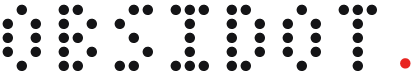
</picture>

<h3>The clock that lives on your desktop.</h3>

<p>It greets you by name. It dances to your music. It keeps your notes and guards your focus.<br>A tiny pet sits on top. And one key turns your whole screen into glass you can shatter.</p>

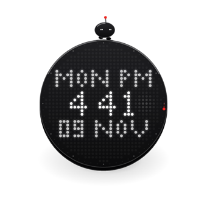

<p><a href="https://github.com/GalacticVraj/obsidot/releases/latest/download/Obsidot.zip"></a></p>

<p><sub><b>113 KB</b> &nbsp;·&nbsp; Windows 10 &amp; 11 &nbsp;·&nbsp; no installer &nbsp;·&nbsp; no account &nbsp;·&nbsp; never goes online &nbsp;·&nbsp; free &amp; open source</sub></p>

<p><a href="https://github.com/GalacticVraj/obsidot/releases/latest"></a>   <a href="LICENSE"></a></p>

<br><br>

<h3>💥 Your screen is made of glass</h3>

<p>Press <kbd>Alt</kbd> + <kbd>K</kbd> on <b>any</b> screen (Chrome, a PDF, your desktop) and it freezes into glass.<br>Crack it. Shatter it. Pull it into a black hole. Press <kbd>Esc</kbd>, and everything is exactly as it was.</p>

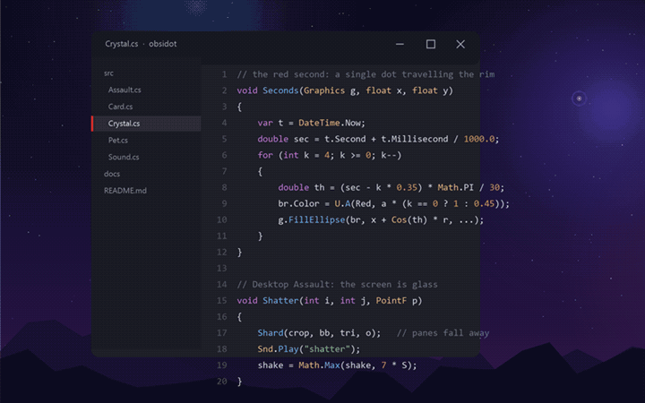

<p><kbd>1</kbd> <b>Pixel Blaster</b> &nbsp;&nbsp; <kbd>2</kbd> <b>Laser Arc</b> &nbsp;&nbsp; <kbd>3</kbd> <b>Crystal Railcannon</b> &nbsp;&nbsp; <kbd>4</kbd> <b>Black Hole</b><br>📁 folders break into chunks &nbsp;·&nbsp; 🖼️ photos burst into pixels &nbsp;·&nbsp; 📄 documents flutter apart &nbsp;·&nbsp; 🗑️ the Recycle Bin detonates</p>

<p><sub><b>Nothing on disk is ever touched.</b> It plays on a snapshot of your screen. Filmed on a real Windows desktop, exactly as it plays when you press Alt + K.</sub></p>

<br><br>

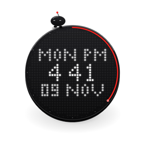

<h3>👋 It knows your name</h3>

<p>The first time it starts, dots stream in from every edge of your screen and assemble the clock. Then it asks what to call you.<br>From then on it's <b>GOOD MORNING</b>, <b>GOOD EVENING</b>, <b>HELLO NIGHT OWL</b>, and <b>WELCOME BACK</b>, by name, scrolling through the dots.</p>

<br><br>

<picture>
  <source media="(prefers-color-scheme: dark)" srcset="docs/media/music-dark.png">
  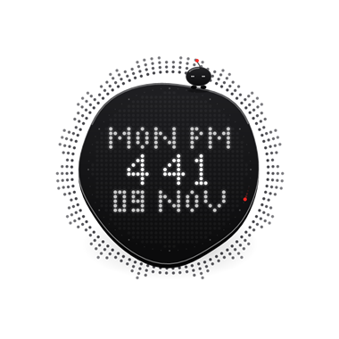
</picture>

<h3>🎵 It dances to your music</h3>

<p>Play anything (Spotify, YouTube, a game) and rays of dots shoot out of the rim like a round spectrum analyser:<br>bass at the top, treble at the bottom, the loudest tip glowing red. The edge turns <b>liquid</b> and wobbles with every kick drum.</p>

<br><br>

<p>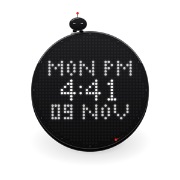&nbsp;&nbsp;&nbsp;&nbsp;&nbsp;&nbsp;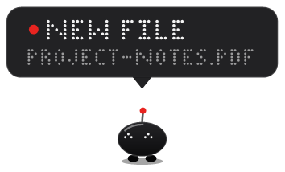</p>

<h3>🐾 A pet that lives on your desk</h3>

<p>A tiny black-glass creature sits on top. Its eyes follow your cursor; it blinks, hops along the rim and bobs to the beat.<br>Click it for a heart. Walk away and it dozes off. When something matters, <b>just the pet</b> drops onto your window with a sign:<br><b>FOCUS DONE</b> &nbsp;·&nbsp; <b>BREAK TIME</b> &nbsp;·&nbsp; <b>BATTERY 12%</b> &nbsp;·&nbsp; <b>NEW FILE</b></p>

<br><br>

<p>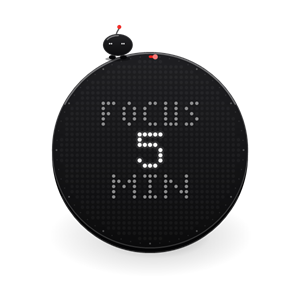&nbsp;&nbsp;&nbsp;&nbsp;&nbsp;&nbsp;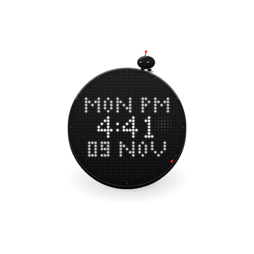</p>

<h3>⌛ Built for focus</h3>

<p><b>Focus Timer:</b> scroll to wind the red arc like a kitchen timer, click, and the dots count down.<br><b>Scratchpad:</b> <kbd>Alt</kbd> + <kbd>Shift</kbd> + <kbd>N</kbd> from any app slides out a notepad that saves as you type.<br><b>The menu:</b> right-click or scroll, and a red pointer turns round six buttons, one soft haptic click at a time.</p>

<br><br>

<p>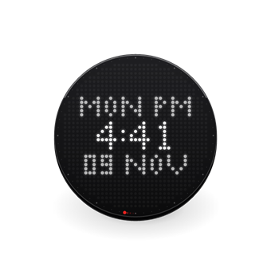&nbsp;&nbsp;&nbsp;&nbsp;&nbsp;&nbsp;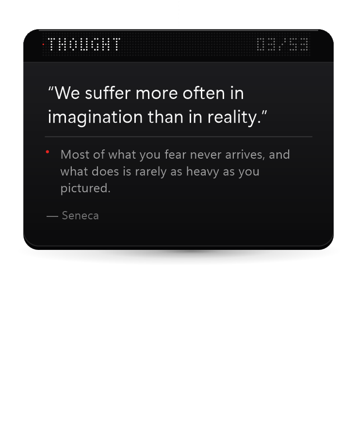</p>

<h3>🏀 And a little play</h3>

<p><b>Vector Hoops:</b> pull and release to throw a light orb through a hoop inside the clock. From the third basket, the pet keeps goal.<br><b>Thought cards:</b> click the clock for a thought, a strange fact or a bit of everyday magic, each with one line of why.</p>

<br><br>

<h3>📥 Get it in 10 seconds</h3>

<p><a href="https://github.com/GalacticVraj/obsidot/releases/latest/download/Obsidot.zip"></a></p>

<p><b>1.</b> Unzip it anywhere &nbsp;&nbsp;→&nbsp;&nbsp; <b>2.</b> Double-click <code>Obsidot.exe</code> and tell it your name &nbsp;&nbsp;→&nbsp;&nbsp; <b>3.</b> Press <kbd>Win</kbd> + <kbd>D</kbd></p>

<p><sub>"Windows protected your PC"? Click <b>More info → Run anyway</b>. SmartScreen is just careful with new apps from independent developers; every line Obsidot runs is in <a href="src">src/</a>.</sub></p>

</div>

<br>

### Controls

| Do this | And |
|---|---|
| Click the clock | A thought card unfolds |
| Right-click or scroll | The menu |
| Drag, or throw it | It glides and bounces off the screen edges |
| Right-click the pet | Change your name |
| Hold the clock still for 2 s | Turn Obsidot off (let go early to cancel) |
| <kbd>Alt</kbd> + <kbd>K</kbd> | Desktop Assault · <kbd>1</kbd>–<kbd>4</kbd> pick a weapon · <kbd>Esc</kbd> to leave |
| <kbd>Alt</kbd> + <kbd>Shift</kbd> + <kbd>N</kbd> | Scratchpad |

**Start with Windows:** press <kbd>Win</kbd> + <kbd>R</kbd>, type `shell:startup`, and drop a shortcut to `Obsidot.exe` into that folder.

### Light on your PC

It lives *behind* your apps, on the desktop, and only wakes when you can see it: about **1% of one CPU core** at rest, practically nothing while a window covers it, about **40 MB** of memory. One 219 KB file: every sound is synthesized live, with no audio files, no images and no dependencies.

### Privacy

Obsidot **never connects to the internet**, and nothing you do is recorded, stored or sent anywhere.

- **Music:** it reads Windows' output level, and while something plays, the sound mix in a small buffer that's constantly overwritten.
- **Away or here:** it reads the time since your last key press or mouse move, never *what* you typed.
- **Downloads:** it notices new file names arriving in your Downloads folder, nothing else.
- **Your data:** your name, settings and notes live in `%APPDATA%\Obsidot`. Delete that folder and they're gone.

### FAQ

<details>
<summary><b>Where did it go? I can't see it.</b></summary>
<br>
It lives on the desktop, under your windows. Press <kbd>Win</kbd> + <kbd>D</kbd>, or launch <code>Obsidot.exe</code> again to call it forward. Choose <b>Float</b> in the menu if you'd rather keep it above everything.
</details>

<details>
<summary><b>How do I turn it off or uninstall it?</b></summary>
<br>
Hold the clock still for two seconds to turn it off. To uninstall, delete <code>Obsidot.exe</code> and the folder <code>%APPDATA%\Obsidot</code>. Nothing else was installed.
</details>

<details>
<summary><b>Does Desktop Assault really break my files?</b></summary>
<br>
No. It photographs your screen and plays on the photo. Your icons and files are never moved, renamed or deleted.
</details>

<details>
<summary><b>Does it work on high-DPI screens and multiple monitors?</b></summary>
<br>
It's per-monitor DPI aware and has been tested on a high-DPI laptop screen. Multiple monitors should work; if something looks off on yours, please <a href="https://github.com/GalacticVraj/obsidot/issues">open an issue</a>.
</details>

### Build it yourself

No Visual Studio and no SDK: it compiles with the C# compiler that's already inside Windows.

```bat
git clone https://github.com/GalacticVraj/obsidot
cd obsidot
build.cmd
```

<details>
<summary><b>How it's made</b></summary>
<br>

About 4,500 lines of C# 5, WinForms and GDI+, no dependencies.

- **Per-pixel-alpha layered windows** (`UpdateLayeredWindow` over a DIB section), pinned in the z-order just above the desktop and raised when you show the desktop.
- **Every frame is drawn by hand.** The dot lettering is a hand-made 5×7 and 3×5 font, so no installed fonts appear in the matrix.
- **Audio:** every sound is synthesized at startup (glass partials, filtered noise, a phone-buzz motor) and mixed on its own thread into one `waveOut` stream. The music rays use WASAPI loopback and a 1024-point FFT into 48 log-spaced bands.
- **Desktop Assault** keeps its own 32-bit DIB back buffer and a jittered glass lattice that cracks and shatters pane by pane, and reads the real icon positions from Explorer's list view.
- **Idle-aware:** 4 Hz at rest, 60 fps only while something moves, almost nothing while covered.

`Obsidot.exe --shots <folder>` renders the main states to PNG. `--anim` and `--assault` render the frames behind the animations on this page; `--assault <dir> screen` waits for <kbd>F9</kbd>, then films it on a real screenshot of your desktop.
</details>

<br>

<div align="center">

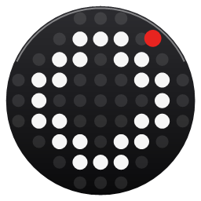

<h3>Your desktop has been waiting for this.</h3>

<p><a href="https://github.com/GalacticVraj/obsidot/releases/latest/download/Obsidot.zip"></a></p>

If Obsidot made your desk a little nicer, <b>⭐ star the repo</b>. It's how other people find it.

<sub>Made with care by <a href="https://github.com/GalacticVraj">GalacticVraj</a> · <a href="LICENSE">MIT License</a></sub>

</div>
